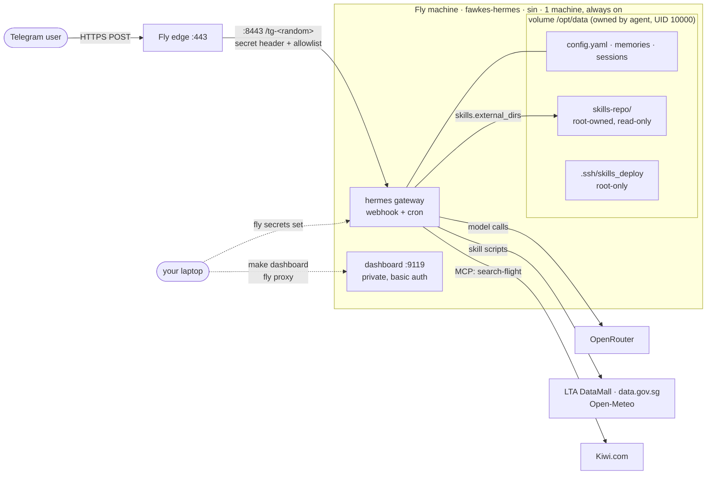

# fawkes-hermes

**Fawkes**: the Hermes bot.

A personal [Hermes Agent](https://hermes-agent.nousresearch.com/docs) deployment on Fly.io: Telegram webhook plus a private dashboard, always on, Singapore region. This is a monorepo for infra, docs and the agent's **skills**.

- **Go-live runbook (start here):** [docs/GO_LIVE.md](docs/GO_LIVE.md)
- **CI/CD & release flow:** [docs/CICD.md](docs/CICD.md)
- **Development handbook:** [docs/DEVELOPMENT.md](docs/DEVELOPMENT.md)
- **Architecture & invariants:** [docs/ARCHITECTURE.md](docs/ARCHITECTURE.md)
- **Design / reference:** [docs/DESIGN.md](docs/DESIGN.md)
- **Security review:** [docs/SECURITY_REVIEW.md](docs/SECURITY_REVIEW.md)

## Architecture at a glance

Details, trust boundaries and invariants: [docs/ARCHITECTURE.md](docs/ARCHITECTURE.md).



How a skill gets from this repo to Hermes:

```mermaid
sequenceDiagram
  autonumber
  participant Dev as You (PR)
  participant GH as GitHub main
  participant CI as deploy-skills (production env)
  participant Root as Fly machine (root via fly ssh)
  participant Agent as Hermes gateway (UID 10000)
  Dev->>GH: merge PR touching skills/ (ci: validate + tests green)
  GH->>CI: push to main
  CI->>CI: validate_skills.py + unittest
  CI->>Root: stream sync-skills.sh over fly ssh (REF = commit SHA, never stored on volume)
  Root->>Root: check deploy key (root, 600, no symlink); system-only PATH
  Root->>GH: git fetch --depth 1 REF over SSH (read-only deploy key)
  Root->>Root: copy skills/ only → stage → chown root, chmod go-w → atomic mv
  Root-->>CI: /opt/data/skills-repo/.revision == SHA ✔
  Agent->>Root: reads skills-repo via skills.external_dirs (read-only)
  Note over Agent: new sessions (/new) see the updated skills
```

## How changes ship

| Change | Path to production |
|---|---|
| Skills (`skills/`, see [skills/README.md](skills/README.md)) | PR → `ci` → merge to `main` → **`deploy-skills`** streams `scripts/sync-skills.sh` over `fly ssh` at that exact commit |
| `fly.toml` / Hermes version | PR → `ci` (image pin check) → merge → **Run workflow `deploy-infra`** (type the version) · CLI fallback `make deploy` |
| Secrets | `fly secrets set` from your laptop (never in git) |
| Agent config / cron | `hx config …` over `make ssh`, or `/cron add` in Telegram |

## Prerequisites

| Tool | Needed for | Install |
|---|---|---|
| `flyctl` | everything on Fly | `brew install flyctl && fly auth login` |
| `gh` | repo, secrets, workflows | `gh auth login` |
| `pre-commit`, `gitleaks` | secret scan on commit **and push**, skills check | `brew install pre-commit gitleaks` |
| `shellcheck` | `make skills-check` (CI runs it too) | `brew install shellcheck` |
| `age` | encrypted backups | `brew install age` |
| Docker | **optional**, only for `make local-*` | Docker Desktop |

Fly doesn't need local Docker. `fly.toml` deploys a prebuilt image, which Fly pulls on its own servers.

## Commands

Run `make` to list targets. The most common:

```bash
make setup                         # once per clone: install pre-commit + pre-push hooks
make lint                          # all hooks on all files
make scan                          # gitleaks: full history + working tree (incl. ignored files)
make skills-check                  # validate skills/ + shellcheck the sync script
make image-digest VERSION=v0.23.0  # get a tag@digest line for fly.toml (no Docker needed)
make deploy                        # lint → check image pin → fly deploy (single machine)
make status | logs | ssh | restart | releases | secrets
make dashboard                     # private dashboard at http://localhost:9119 via fly proxy (docs/DESIGN.md §8)
make webhook-info | webhook-test   # Telegram webhook checks (inputs prompted, hidden)
make sync-skills [REF=<sha>]       # manual skills publish (default: origin/main)
make test | test-live              # skill script tests (fixtures | plus live APIs, keys from .env.local)
make skill-secrets                 # push skill API keys from .env.local to Fly (restarts the machine)
make backup AGE_RECIPIENT=age1...  # encrypted backup to ~/hermes-backups
```

## Run locally (optional, needs Docker)

This runs a local copy of Hermes using the same pinned image as production (read from `fly.toml`). `./skills` is mounted read-only at the production path, so you can try skill edits live.
It differs from production in three ways:
- Telegram uses **polling** with a **separate dev bot**.
- The dashboard listens on `127.0.0.1` only.
- State lives in a local Docker volume.

> ⚠️ Never use the production bot token locally. A second gateway would conflict with the Fly webhook or take it over.

```bash
cp .env.local.example .env.local   # fill in a DEV bot token, a dev OpenRouter key and dashboard auth
make local-up                      # preflight checks, then docker compose up
make local-hx ARGS="skills list"   # any hermes CLI command (runs as the hermes user)
make local-logs | local-doctor | local-down | local-reset
```

## Ground rules

- **No secrets in this repo.** Secret names are listed in `.env.example` and `.env.local.example`; values live in Fly secrets, GitHub environment secrets and your password manager.
- **Pin everything:** the image by `tag@sha256:digest`, actions by commit SHA, MCP packages by exact version.
- **Only 443 → 8443 is public.** Never add the dashboard (9119) or API server (8642) to `[[services]]`.
- **Treat the agent as potentially hostile:** root never executes anything under `/opt/data`, and skills are published root-owned and read-only.
- No `pull_request_target` workflows. `FLY_API_TOKEN` lives in the `production` environment, which only `main` can use (`deploy-skills`, `deploy-infra`).

## Layout

```
.
├── skills/                     # agent skills; only skill dirs reach the machine
│   ├── README.md · AGENTS.md   # catalog + authoring guide (Hermes SKILL.md best practices)
│   └── <name>/SKILL.md
├── scripts/
│   ├── sync-skills.sh          # runs as root on Fly, streamed in by CI / make
│   └── validate_skills.py      # pre-commit + CI gate
├── .github/
│   ├── workflows/ci.yml        # PRs: lint, validate, shellcheck, image pin (no secrets)
│   ├── workflows/deploy-skills.yml   # main: publish skills (production env)
│   ├── workflows/deploy-infra.yml    # manual: fly deploy + verify (production env)
│   └── dependabot.yml          # action-update alerts → make adopt-pr PR=<n>
├── tests/                      # skill script tests + recorded API fixtures (never published)
├── docs/                       # GO_LIVE, CICD, DESIGN, SECURITY_REVIEW, TRAVEL_SKILLS
├── AGENTS.md · CLAUDE.md       # agent guidance (CLAUDE.md imports AGENTS.md)
├── Makefile · compose.yaml
├── .env.example · .env.local.example
├── .gitleaks.toml · .pre-commit-config.yaml
└── (fly.toml)                  # add at go-live step 4
```
